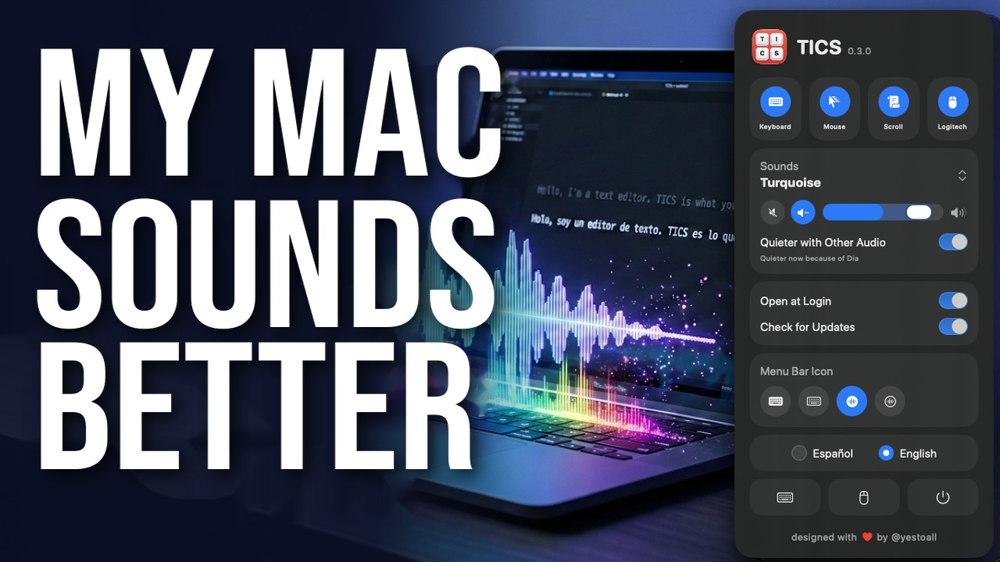

# TICS

[Leer en español](README.es.md)

Make your Mac sound like a mechanical keyboard when you type, and like a mouse when you click.

Version 0.3.0

[](https://youtu.be/_GZCnr1pWfg)

**[Watch it on YouTube](https://youtu.be/_GZCnr1pWfg)**, with sound on.

## Download

**[Download TICS](https://github.com/yestoall/tics/releases/latest/download/TICS.dmg)**, free.
Open the .dmg and drag TICS to Applications. It needs macOS 14 or later and works on Apple
silicon and Intel Macs. The first time you open it, macOS asks for permission to listen to the
keyboard.

Or install it with [Homebrew](https://brew.sh):

```bash
brew install --cask yestoall/tap/tics
```

To update it later, run `brew upgrade --cask tics`.

## Why

I made TICS for myself. There's something about the clack of a mechanical keyboard that feels
good: every key answers back. I'd been using [JoyTap](https://setapp.com/apps/joytap), a paid app
that does something similar, but I kept missing things, like hearing the mouse too. So I built my
own.

If you think of a way to make it better, [open an issue](https://github.com/yestoall/tics/issues).
Maybe I'll build it, or maybe you'd rather build it yourself.

## What it does

TICS lives in the menu bar. Every key you press, in any app, plays the sound of the keyboard you
choose.

- **11 keyboards**: Cherry MX Blue, Brown and Red, Holy Panda, Cream, MX Blue, MX Brown, Oreo,
  Topre Purple, Turquoise, and a synthetic one generated in code.
- **Press and release** sound different, and holding a key down sounds softer on each repeat.
- **Every keystroke a little different**: the pitch shifts slightly from one press to the next,
  like a real keyboard. Turn it off with **Vary Pitch**, in **Set Up Keyboard…**.
- **Clicks, drags and scrolling**: your mouse makes sounds too, at the same volume as your
  keyboard. Dragging sounds like a ratchet, faster the quicker you move, and the scroll wheel
  clicks with every notch.
- **Mouse Settings**: set the pitch, volume and how dry or hollow each button, dragging and the
  scroll wheel sound, and hear them as you go.
- **Logitech mice**: if Logi Options+ takes over a button (back, forward, gestures…), turn on the
  Logitech tile and it makes a sound too. Works with the mouse connected over Bluetooth. With an
  MX Master 4, each button can also vibrate when you press it, with the effect you pick in Mouse
  Settings.
- **Quieter with other audio**: while music, a video or a call is playing, TICS drops to 40% of
  your volume, and comes back a few seconds after it stops. You can also make it quieter or silence
  it from the volume row, without quitting it.
- **English and Spanish**: TICS follows your Mac's language.

## Privacy

TICS needs **Input Monitoring** permission to know which key you press and pick its sound. It
only listens: it never saves what you type or where you click.

To know when other audio is playing, TICS checks which apps are using the speakers, as macOS
reports it. It doesn't listen to what they play and doesn't ask for any permission.

TICS only connects to the internet when it opens and once a day after that, to ask GitHub for the
number of the latest version. It sends nothing else. If there's a newer one, the panel tells you
and the menu bar icon gets a red dot. Turn off **Check for Updates** in the panel and TICS never
connects at all.

With the Logitech tile on, TICS also asks for **Bluetooth** permission, to hear the buttons
Logi Options+ takes over. It only listens for when you press and release them: it doesn't change
anything on your mouse.

## Build

You need macOS 14 or later and Swift 6 (Xcode or its command line tools).

```bash
bun run dev     # debug build, then opens the app
bun run build   # release build: build/Tics.app
bun run test    # the tests
```

Without Bun: `scripts/build-app.sh release && open build/Tics.app`.

The app is signed with your “Apple Development” certificate if you have one, or with any identity
you set in `SIGN_IDENTITY`. Without a certificate it's signed ad hoc: it works the same, but macOS
asks for the permission again after every build.

## Sounds

The keyboards use the [Mechvibes](https://github.com/hainguyents13/mechvibes) format and come
from two MIT-licensed projects:

- [Mechvibes](https://github.com/hainguyents13/mechvibes): Oreo, Cherry MX Blue, Brown and Red,
  and Topre Purple. License in `Resources/SoundPacks/LICENSE-mechvibes`.
- [kbsim](https://github.com/tplai/kbsim): Holy Panda, Cream, MX Blue, MX Brown and Turquoise.
  Each folder includes its license.

Mouse clicks and the synthetic keyboard don't come from any file: TICS generates them on the fly.

## License

[MIT](LICENSE).

designed with ♥ by [@yestoall](https://yestoall.com)
